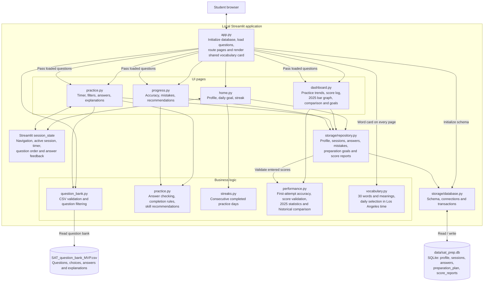

# SAT Prep

A local-first SAT practice app built with Streamlit for family use. It reads 70 SAT-style questions from `SAT_question_bank_MVP.csv` and saves the student profile, practice history, preparation goals, and manually entered test scores in SQLite.

## Current features

| Area | Features |
| --- | --- |
| Home | Editable student name, daily completion status, practice streak, and a button to start practice. |
| Practice | Fixed 20-minute goal, live timer, subject and difficulty filters, shuffled questions, immediate answer feedback, a basic skill hint after answering, and explanations. |
| Progress | Overall answer-attempt accuracy, up to 20 recent mistakes to review, and up to three skill recommendations based on low accuracy. |
| Dashboard | First-attempt accuracy, subject and skill breakdowns, daily charts, and question-bank coverage. |
| Score analyzer | Saved SAT, Bluebook SAT practice, and PSAT results with test dates; SAT comparisons with 2025 averages and readiness benchmarks; SAT/Bluebook score trends and deletion of incorrect entries. |
| 2025 statistics | Interactive bar graph of six SAT total-score bands, with student counts and calculated percentages in tooltips. |
| Preparation goals | Editable graduation year and target SAT score, initially 2030 and 1400. |
| Daily vocabulary | A word and quick meaning at the top right of every page, rotating through 30 words daily. |
| Question bank | 35 Math and 35 Reading & Writing questions, including a balanced 20-question original pilot with Easy, Medium, and Hard questions. |

Use the sidebar to switch between **Home**, **Dashboard**, **Practice**, and **Progress**. This version uses one shared local student profile.

## Architecture

The app runs as a local Streamlit application. Arrows show component calls or data access; the browser displays the UI while Python handles practice rules and storage.



- **Question content:** Loaded and validated from CSV, then passed to Practice, Progress, and Dashboard. Subject and difficulty filters operate on the loaded questions.
- **Active practice:** Streamlit session state tracks the timer and current question across UI reruns.
- **Saved progress:** SQLite persists the student profile, sessions, answers, preparation plan, and score reports. Each answer belongs to a session through `answers.session_id`; new tables are created automatically without replacing existing history.
- **Recommendations and streaks:** Computed from saved answer history and completed session dates.
- **Dashboard calculations:** First-attempt summaries ignore subsequent submissions for the same question within a session. The existing Progress page reports all saved answer attempts.
- **Historical statistics:** The 2025 averages and score-band counts are stored in `services/performance.py`. Charts render locally; the app does not call College Board or Google at runtime. Source links and the verification date appear in the dashboard.
- **Daily vocabulary:** The entry point renders a shared card using `services/vocabulary.py`. A Streamlit fragment refreshes it every 60 seconds; the practice timer has its own one-second fragment.

### Code and storage map

| Location | Responsibility |
| --- | --- |
| `src/sat_prep/app.py` | Startup, sidebar routing, question-bank loading, and shared vocabulary card. |
| `src/sat_prep/pages/` | Home, Dashboard, Practice, and Progress UI. |
| `src/sat_prep/services/` | Question filtering, practice rules, streaks, performance summaries, score statistics, and vocabulary selection. |
| `src/sat_prep/storage/` | SQLite schema, transactions, and persistence operations. |
| `SAT_question_bank_MVP.csv` | Question content, choices, keyed answers, explanations, and provenance. |
| `data/sat_prep.db` | Local `profile`, `sessions`, `answers`, `preparation_plan`, and `score_reports` tables; excluded from Git. |
| `tests/` | Question-bank integrity, practice rules, streaks, persistence, score analysis, vocabulary rotation, and Streamlit UI/navigation checks. |

## Performance dashboard

A **SAT word of the day** card appears at the top right of each page. It rotates through 30 locally authored word meanings on a daily schedule using America/Los_Angeles time and refreshes within a minute of midnight while the page is open. These are SAT-style vocabulary practice, not an official SAT word list.

Open **Dashboard** in the sidebar to see first-attempt practice accuracy, subject and skill breakdowns, daily trends, and question-bank coverage. Only the first submission for a question within a session counts toward dashboard accuracy; the same question in a later session counts as another attempt.

The **Test scores and 2025 comparison** tab saves manually entered SAT, Bluebook SAT practice, and PSAT results locally. SAT and Bluebook SAT practice results can be compared with College Board's graduating class of 2025 averages: **1029 total, 521 Reading & Writing, and 508 Math**. PSAT scores are logged separately rather than treated as SAT scores. Scores can be removed if entered incorrectly.

That tab also displays a **2025 SAT total-score distribution** bar chart covering six score ranges, from 400–590 to 1400–1600. Bar heights are percentages computed from published counts for 2,004,965 students; tooltips show the range, student count, and percentage. The chart is available even before a personal score is entered.

The preparation plan defaults to high school graduation in **2030** and an editable **1400** SAT target. Neither is a forecast or an admissions requirement. Practice accuracy is not converted into a SAT score; the question bank is not calibrated to official scoring. The historical averages describe 2025 graduates' most recent SAT scores, not expected 2030 performance. SAT readiness benchmarks are 480 Reading & Writing and 530 Math.

Sources checked October 11, 2026: [2025 College Board annual report](https://reports.collegeboard.org/media/pdf/2025-total-group-sat-suite-of-assessments-annual-report.pdf), [readiness benchmarks](https://satsuite.collegeboard.org/k12-educators/about/understand-scores-benchmarks/benchmarks), and [SAT scoring](https://satsuite.collegeboard.org/scores/what-scores-mean/how-scores-calculated). Existing local databases gain preparation-plan and score-report tables automatically when the app starts.

## Run locally

Install [uv](https://docs.astral.sh/uv/getting-started/installation/) if it is not already installed, then run:

```powershell
uv sync
uv run streamlit run src/sat_prep/app.py
```

The database is created automatically at `data/sat_prep.db`. It stays local to this machine and is excluded from git.

## Run tests

```powershell
uv run pytest
```

The current suite contains 20 tests, including dashboard score entry/deletion, PSAT separation, and vocabulary visibility across all four pages.

## Notes about the supplied question bank

The CSV contains 70 SAT-style practice questions: the original 50 plus a 20-question pilot with IDs `P_M001`–`P_M010` and `P_R001`–`P_R010`. The pilot includes 10 Math and 10 Reading & Writing questions; each subject has 3 Easy, 4 Medium, and 3 Hard questions. Across the pilot, each answer letter is correct five times.

The pilot questions are original, AI-authored content with checked answers and worked explanations. They are not official College Board questions and have not been independently reviewed by an educator. Difficulty labels and time estimates are author estimates, not calibrated measurements. Review them with a parent or tutor before relying on them for assessment; practice accuracy is not an official SAT score estimate.

Pilot rows include provenance, a `pilot-20` tag, and estimated question times. The app continues to use a fixed 20-minute session goal. The original 50 questions have blank time estimates and no correct answers keyed as D, so the combined bank still needs broader balancing.
