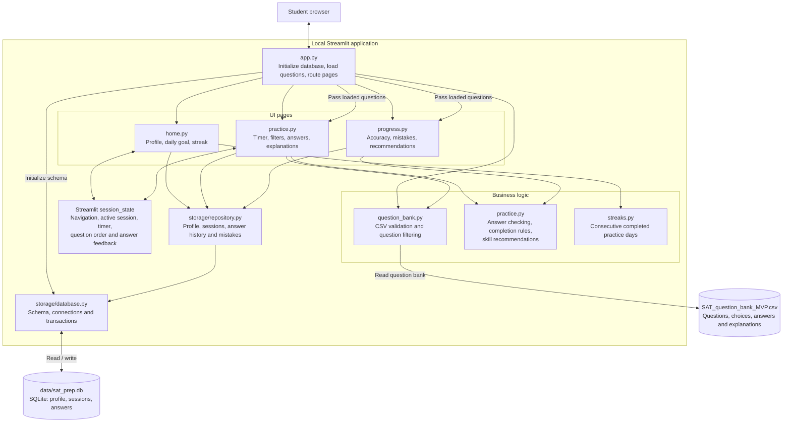

# SAT Prep

A local-first SAT practice app built with Streamlit. It reads the question bank from `SAT_question_bank_MVP.csv` and stores profile, practice sessions, and answer history in SQLite.

## Architecture

The app runs as a local Streamlit application. Arrows show component calls or data access; the browser displays the UI while Python handles practice rules and storage.



- **Question content:** Loaded from CSV into memory and passed to Practice and Progress.
- **Active practice:** Streamlit session state tracks the timer and current question across UI reruns.
- **Saved progress:** SQLite persists the student profile, session records and answer history. Each answer belongs to a session through `answers.session_id`.
- **Recommendations and streaks:** Computed from saved answer history and completed session dates.

## Run locally

Install [uv](https://docs.astral.sh/uv/getting-started/installation/) if it is not already installed, then run:

```powershell
uv sync
uv run streamlit run src/sat_prep/app.py
```

The database is created automatically at `data/sat_prep.db`. It stays local to this machine and is excluded from git.

## Run tests

```powershell
uv run pytest
```

## Notes about the supplied question bank

The current CSV has 50 questions, all with Easy or Medium difficulty. Its `Estimated_Time_Sec` values are blank and no correct answers are keyed as D. The app therefore uses a 20-minute session timer rather than per-question time estimates, and the question bank should be balanced before using answer-choice patterns as an indicator of correctness.
