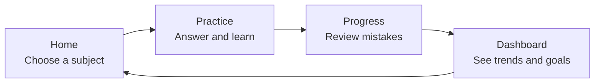
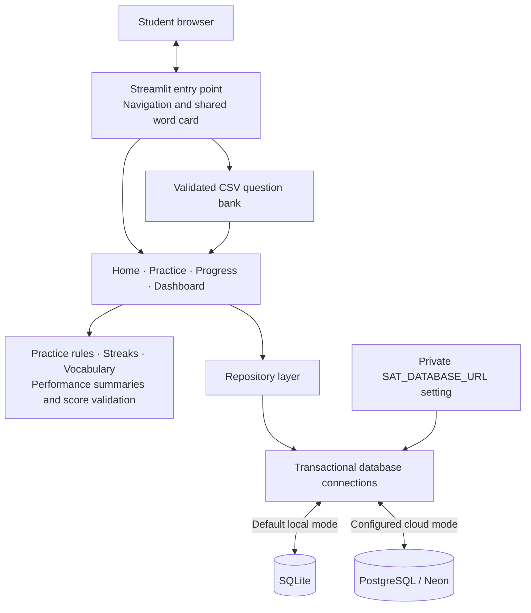

# SAT Prep App Demo Guide

SAT_app helps a student build a daily SAT practice habit, learn from mistakes, and track preparation over time. It began as a family learning project: building an app with AI-assisted coding while creating useful practice for a student preparing to graduate high school in 2030.

This guide supports a five-minute product demo followed by a short technical explanation. It describes the implemented app as of October 11, 2026.

## Opening pitch

> “SAT Prep makes the next step simple: practice for 20 minutes, understand your answers, and see which skills need attention. It combines a welcoming learning space with progress tracking and real test-score comparisons.”

The primary user is a student; a parent can help review explanations and monitor progress. The current version has one shared student profile.

## MVP at a glance

The MVP is the complete daily practice loop, rather than a full SAT exam simulator.



| Capability | What the demo shows | Student benefit |
| --- | --- | --- |
| Welcoming Home page | Compact welcome banner, subject cards, streak, and daily mission | A clear starting point without an overwhelming screen |
| Focused practice | A 20-minute timer, randomized questions, subject/difficulty filters | A manageable daily routine |
| Answer feedback | Correctness, correct answer, and stored explanation | Learn why an answer works |
| Mistake review | Recent missed answers and explanations | Turn mistakes into follow-up learning |
| Skill recommendations | Up to three low-accuracy skills, each with at least two recorded attempts | Identify practice priorities |
| Persistent local history | Saved profile, sessions, and answers | Continue tracking between app launches |

## Features added beyond the initial MVP

| Feature | What is implemented |
| --- | --- |
| Performance dashboard | First-attempt accuracy, subject and skill breakdowns, daily accuracy charts, and question-bank coverage |
| Test-score log | Dated SAT, Bluebook SAT practice, PSAT/NMSQT or PSAT 10, and PSAT 8/9 results; removal of incorrect entries |
| Historical score analyzer | SAT/Bluebook comparisons with 2025 averages and SAT readiness benchmarks; trends kept separate by test type |
| 2025 score-distribution graph | Six total-score bands with percentages and student-count tooltips; available without a personal score |
| Preparation goals | Editable graduation year and target SAT total; starting values are 2030 and 1400 |
| Word of the day | 30 locally authored words and meanings, rotating daily in America/Los_Angeles time |
| Expanded question bank | 70 SAT-style questions: 35 Math and 35 Reading & Writing |
| Original pilot batch | 20 added questions with explanations; each subject has 3 Easy, 4 Medium, and 3 Hard questions; five correct answers per letter across the pilot |
| Cloud-storage support | PostgreSQL backend, versioned schema, encrypted connection configuration, and a backup/verification migration CLI |

The pilot is original, AI-authored, answer-checked content, not official College Board material. Independent educator review and calibrated difficulty are still pending. The original 50 questions remain less balanced than the pilot.

## Five-minute demo walkthrough

Before presenting, start the app and verify it loads. Use a separate local checkout with no cloud connection for a demo that needs fictional scores. If using existing practice history, choose a student-approved view of the data. No demo data is automatically inserted by this guide.

```powershell
uv sync
uv run streamlit run src/sat_prep/app.py
```

Open `http://localhost:8501`. A short demo does not require waiting for the full 20-minute goal.

| Time | Action | Talking point |
| --- | --- | --- |
| 0:00–0:45 | Open **Home**. Point to the greeting, daily mission, learning cards, and word card. | “The page gives a student one clear next step. Navy provides structure; teal actions and an ivory background keep it approachable.” |
| 0:45–2:00 | Click **Practice math**. Show the countdown and filters. Answer a question, click **Check answer**, then open **Step-by-step explanation**. | “Feedback is immediate, and explanations make practice a learning activity.” |
| 2:00–2:45 | Open **Progress**. Show recent mistakes and recommendations if history is available. | “The app records what happened and helps identify weaker skills. Recommendations need at least two attempts in a skill.” |
| 2:45–3:30 | Open **Dashboard → Practice performance**. Show subject accuracy, daily trends, and skill attempts. | “This dashboard uses the first submission for each question in a session, so checking an answer twice does not inflate accuracy.” |
| 3:30–4:30 | Open **Test scores and 2025 comparison**. Show the distribution graph and a saved SAT result, or add the fictional example below in the demo copy. | “Actual reported scores are compared with historical SAT results. Practice accuracy is displayed separately.” |
| 4:30–5:00 | Show **Preparation goals**, then return to Home. | “The next session connects daily habits with a longer-term goal.” |

For an empty account, show the empty-state messages instead of implying that charts or recommendations already contain evidence. After demonstrating a short session, return to Practice and use **End session without completing goal**; it records an unfinished session without earning a streak. A completed streak requires reaching 20 minutes and clicking **Finish session**.

### Example score analysis

Use these fictional values only in a demo copy, with a test date no later than today:

| Input or result | Value |
| --- | --- |
| Test type | SAT |
| Reading & Writing | 600 |
| Math | 650 |
| Total | 1250 |
| Difference from 2025 total average | +221 |
| Difference from Reading & Writing average | +79 |
| Difference from Math average | +142 |
| Points remaining to a 1400 target | 150 |
| SAT readiness benchmarks | Both met: Reading & Writing 480; Math 530 |

PSAT results are stored under their own test type and do not appear as SAT results in the historical analyzer. A Bluebook result is identified as a practice result.

The comparison uses the most recent SAT scores of students graduating high school in 2025: average total **1029**, Reading & Writing **521**, and Math **508**. The distribution represents **2,004,965** students. These values come from the [College Board 2025 annual report](https://reports.collegeboard.org/media/pdf/2025-total-group-sat-suite-of-assessments-annual-report.pdf); readiness thresholds come from [College Board benchmarks](https://satsuite.collegeboard.org/k12-educators/about/understand-scores-benchmarks/benchmarks).

## Framework and technology

| Technology | Role in SAT_app |
| --- | --- |
| Python | Application code, answer rules, data validation, and analytics |
| Streamlit | Browser UI, navigation, forms, session state, and timed fragments |
| Pandas | Tables and chart-ready data transformations |
| Altair / native Streamlit charts | Interactive score distributions and practice trends |
| CSV | Portable question content, choices, answers, explanations, and provenance |
| SQLite | Default local progress database with transactions and foreign keys |
| PostgreSQL + psycopg 3 | Configurable cloud progress storage and parameterized database queries |
| Neon | Selected managed PostgreSQL provider; project/connection setup remains pending |
| uv + Hatchling | Dependency locking, environment setup, and Python packaging |
| pytest + Streamlit AppTest | Logic, storage, migration, and UI interaction checks |
| Git + GitHub | Source versioning and the repository used for deployment |
| Streamlit Community Cloud | Documented hosting route; the live app URL/deployment has not been verified in this project workflow |

AI-assisted coding is part of the development workflow. There is no AI tutor, generative-question API, or live external question-bank API running inside the current app.

## Architecture to explain during the demo



The UI pages handle interaction, services compute learning metrics, and the repository handles persistence. This separation lets the app change its database backend while retaining the practice flow.

| Stored data | Table |
| --- | --- |
| Student name and daily goal | `profile` |
| Session times, duration, and completion | `sessions` |
| Answers linked to sessions | `answers` |
| Graduation year and target score | `preparation_plan` |
| Manually entered test results | `score_reports` |
| Applied PostgreSQL schema versions | `schema_migrations` (cloud backend only) |

Questions stay in CSV. The database stores question IDs and answer history, so changes to question IDs need care to preserve mistake review.

## What to say about readiness

- **Working locally:** daily practice, review, charts, score logging, vocabulary, and profile/goal settings.
- **Implemented but awaiting live setup:** Neon storage and migration. The import backs up SQLite, preserves IDs, verifies rows, and refuses to overwrite existing cloud progress.
- **Verification at this revision:** 34 tests passed; the separate live PostgreSQL integration test was skipped because no test database was configured.
- **Not yet built:** separate student accounts, a calibrated SAT score predictor, adaptive exam simulation, automatic weak-skill question selection, spaced repetition, and a reviewed large-scale content bank.

Practice accuracy is not converted into a SAT score. The 2025 graduating-class statistics provide historical context rather than a forecast for the student's 2030 graduation.

## Closing pitch

> “The app already supports a complete practice-and-review routine. The next milestones are connecting persistent cloud storage and expanding the reviewed question bank, while keeping the experience simple for the student.”

See the [README](../README.md) for setup, the detailed architecture, and Neon migration commands. Use `uv run pytest` to rerun the tests before a presentation.
